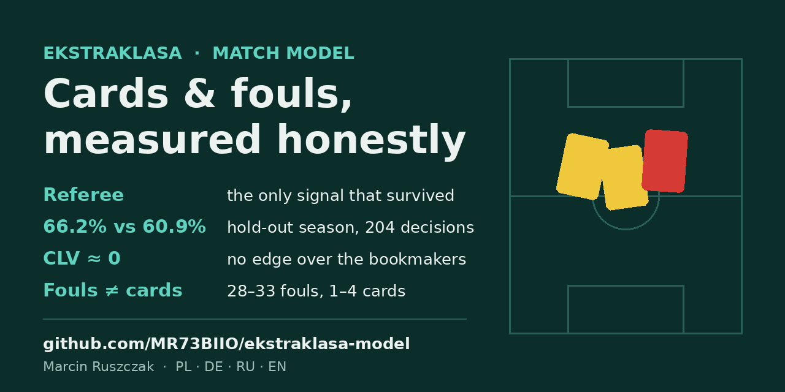

# ekstraklasa-model

How many cards and fouls will a match in the Polish Ekstraklasa have, and what really moves that number?

I started this in July 2026 as a betting question. It became a measurement project. The model is built from the referee, the teams and the players on the pitch, and every idea has to beat a simple baseline on matches it has not seen. Most ideas did not.

This repo shows the method, what survived, what was rejected, and why.

## Short version

- **The referee is the only signal that survived every test.** 28 referees, from 3.94 to 5.51 cards per match in their history.
- **On a hold-out season the referee model is right more often than the league average:** 66.2% vs 60.9% on 204 decisions out of 297 matches. With a stricter threshold: 79% on 57 decisions.
- **It does not beat the bookmakers.** On the first clean test with real prices before the match (28 bets) the closing line value was about zero (raw −0.2%, adjusted −0.4%). The cards market in Ekstraklasa is priced well.
- **Fouls are not cards.** Matches with 28 to 33 fouls ended with 1 to 4 cards. A nervous match in fouls does not mean a nervous match in cards.
- **Cards jump a lot from round to round** (2.56, 5.25, 3.1, 3.5 per match in rounds 6 to 9). One round says almost nothing about the model.
- **Several attractive ideas were tested and rejected:** young players get more cards, national team breaks, a rule change between seasons, coaches taking off booked players, an xG strategy with +96% ROI. The details are in [`docs/findings.md`](docs/findings.md).

## What the model looks at

| Layer | What | Status |
|---|---|---|
| Referee | cards and fouls per match from his history (λ), corrected to the current season | in the model |
| Teams | fouls of both teams | in the fouls model, not in the cards model (overfits on cards) |
| Players | 434 player profiles, and from November per-match player statistics for 115 matches: minutes, fouls committed and drawn, cards, duels, passes | basis for the fouls model and for scouting |
| Context | coach under pressure, derby, cup match in the week, weather | collected, tested match by match, not in the model |
| Market | over/under lines for cards from 5 Polish bookmakers | used only to check the model, never as an input |

How it is built and the rules I follow: [`docs/method.md`](docs/method.md).
All findings with numbers and sample sizes: [`docs/findings.md`](docs/findings.md).
How the project went, month by month: [`docs/timeline.md`](docs/timeline.md).

## Rules I keep

- **No look-ahead.** Only what is known before kick-off goes into a prediction. Fouls of the match itself are used for fitting, never for the prediction of that match.
- **Baseline first.** A new signal has to beat the referee alone, or it is out.
- **The price decides, not the history.** A model that fits the past but does not beat the closing price has no edge.
- **Predictions are written before the match.** From round 11 every round is committed here before the first kick-off, and the result is added after the round.
- **Small samples stay small.** A rule from 2 or 12 matches is a hypothesis, not a finding.

## What is not here

- No raw data from the sources. The data comes from public match pages and one paid statistics service, and it is not mine to share. Here are only my own predictions, results and calculations.
- No betting advice. This is a measurement project.
- The code runs on my server and is not published in this repo yet.

## Current status

- Rounds 11 to 13 run through the engine, each prediction committed before the first kick-off.
- Cards against the closing market, three rounds together: the market is better (log-loss 0.699 vs 0.734, 23 matches). The model is level with a flat average. No edge, as in the first price test in Round 6.
- Fouls, three rounds together: the referee-based models beat the constant by about 0.4 fouls per match (24 matches), but the winner still changes from round to round.
- Round 13 failed its own process rules: the scraped match pages changed during the round and needed three code fixes and two manual inputs.
- Fix: the player data (line-ups, minutes, events, player statistics) now comes from a structured statistics API. Rounds 1 to 13 are loaded, 115 matches.
- The model was not changed: the pre-defined R1 condition was not met in any of the three rounds.
- Next: Round 14 with the new data source, under the same rules.

---

Marcin Ruszczak · PL · DE · RU · EN
